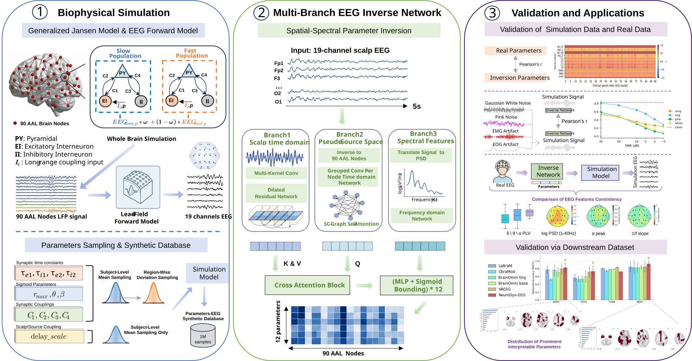

# NeuroDyn-EEG

**NeuroDyn-EEG: An Interpretable Pre-trained Model for EEG Based on Neural Dynamics**

Code for parameter sampling and simulation, inverse model training, three levels of validation, and plotting. The arXiv link will be added after the paper is released.



## 1. Setup and Data Layout

Run all commands from the project root.

```powershell
python -m pip install -r validation/requirements.txt
python -m pip install -r validation/neurodyneeg-validation/requirements.txt
```

Also install the version of `eegaux` compatible with the original experiments, providing `montage.STANDARD_1020 / STANDARD_1005` and `preprocessing.set_data_RFN`. Place the simulation resources and data as follows:

```text
neurodyn_eeg/
  utils/
    fsaverage_volume_forward_solution.fif
    AAL_regions_MNI_90_MatchVolfwd.csv
    SCmatrices88healthy.mat
  TrainData/NeuroDynV1/   # Training data generated by sampling and simulation
  validation_data/      # Independent simulated validation data
  RealData/             # User-provided real EEG and participant manifests
```

Data, the simulation resources listed above, and trained weights (`.pth`) are not included. Use your own trained weights for validation.

| Configuration | Purpose |
|---|---|
| [TrainWorks/config/neurodyneeg.yaml](TrainWorks/config/neurodyneeg.yaml) | Training data paths, batch size, epochs, and output locations |
| [TrainWorks/src/config_params.py](TrainWorks/src/config_params.py) | Parameters used for training and plotting |
| [validation/config/validation.json](validation/config/validation.json) | Validation data, manifests, weights, and cache paths |

## 2. Parameter Sampling and Simulation

Sample parameters first, then simulate regional source signals. Use the same directory for both steps.

```powershell
python -m paramsampling.sample_main --out_dir TrainData/NeuroDynV1 --n_total 1000000 --chunk_size 1000 --seed 20260922

python -m paramsampling.simulate_signal --chunk_dir TrainData/NeuroDynV1 --n_jobs 10
```

Outputs are stored as `chunk_*_Param14.npz`. Sampling writes `params`, and simulation adds `SimData (N, 90, 1280)`. The regional signals are projected to 19-channel EEG during training. Use a new data directory when changing the sampling scheme.

## 3. Model Training and Loss Curves

```powershell
python -m TrainWorks.scripts.train --config TrainWorks/config/neurodyneeg.yaml --chunk_dir TrainData/NeuroDynV1 --resume never

python -m TrainWorks.scripts.plot_training_loss
```

Best checkpoint: `TrainWorks/checkpoints/neurodynEEG_best.pth`. Logs and loss curves: `TrainWorks/logs/`.

To resume training, replace `--resume never` with `--resume auto`. The default configuration reserves 10 validation chunks and requires at least 11 fully simulated chunks. For smaller runs, reduce `data.val_chunks` and `train.batch_size` in the configuration.

## 4. Validation Level 1: Simulated Parameter Recovery and Noise Robustness

Generate an independent validation set using a separate directory and a different seed. This example uses 10,000 samples. The default `paths.checkpoint` in the validation configuration points to the best checkpoint from the training step.

```powershell
python -m paramsampling.sample_main --out_dir validation_data --n_total 10000 --chunk_size 1000 --seed 400000000

python -m paramsampling.simulate_signal --chunk_dir validation_data --n_jobs 10

python -m validation.scripts.run_inversion --experiment recovery --output validation/results/recovery_v1

python -m validation.scripts.run_inversion --experiment noise --output validation/results/noise_v1
```

Plot parameter recovery and noise robustness:

```powershell
python validation/neurodyneeg-validation/scripts/plot_results.py recovery --results validation/results/recovery_v1

python validation/neurodyneeg-validation/scripts/plot_results.py noise --results validation/results/noise_v1 --scope pooled
```

For validation and plotting, `--output` must point to a directory that does not already exist. Use new directory names for subsequent runs and update the plotting inputs accordingly.

## 5. Validation Level 1: Real EEG Inversion and Closed-Loop Reconstruction

Fill in the [participant manifest template](validation/config/participants.example.csv) with your recordings. The `path` field is relative to `RealData/`. Set `label` to 0 for controls/normal recordings or 1 for cases/abnormal recordings. See the [validation documentation](validation/README.md) for input formats.

Copy `validation/config/validation.json` to `validation/config/closed_loop.json` and change only the following two fields to prepare separate cohorts for closed-loop validation and classification:

| Configuration field | Original configuration: classification and group analysis | closed_loop.json: closed-loop validation |
|---|---|---|
| `paths.manifest` | `RealData/participants.csv` | `RealData/participants_closed_loop.csv` |
| `paths.prepared_dir` | `validation/cache/real` | `validation/cache/closed_loop` |

Use `participants_closed_loop.csv` for the closed-loop cohort, such as a healthy cohort, and `participants.csv` for AD65, PD31, MDD, and TUAB classification records. For TUAB, set `official_split` to `train` or `eval`.

Preprocess EEG and infer parameters, then reconstruct EEG with the forward model:

```powershell
python -m validation.scripts.prepare_real_data --config validation/config/closed_loop.json

python -m validation.scripts.run_inversion --config validation/config/closed_loop.json --experiment closed_loop --output validation/results/closed_loop_v1
```

The preparation directory, `paths.prepared_dir`, must also be new. Closed-loop validation processes all recordings in this cache.

Plot real EEG topographic maps (the original right panel), PLV, and PSD:

```powershell
python validation/neurodyneeg-validation/scripts/plot_results.py real-eeg --metrics validation/results/closed_loop_v1/closed_loop_segments.csv

python validation/neurodyneeg-validation/scripts/plot_results.py closed-loop-signals --results validation/results/closed_loop_v1 --prepared validation/cache/closed_loop
```

To plot a single segment's waveforms, append `--segment-id YOUR_SEGMENT_ID` to the last command, replacing `YOUR_SEGMENT_ID` with an actual segment ID.

## 6. Validation Level 2: Downstream Classification

Prepare the classification cohorts using the original configuration, then train and evaluate the classification head:

```powershell
python -m validation.scripts.prepare_real_data

python -m validation.scripts.run_downstream --dataset AD65 --dataset PD31 --dataset MDD --dataset TUAB --output validation/results/downstream_v1

python validation/neurodyneeg-validation/scripts/plot_results.py downstream --run NeuroDynEEG validation/results/downstream_v1/runs.csv
```

Keep only the `--dataset` arguments for the cohorts you have prepared. Dataset names must match the manifest. Figshare MDD is named `MDD` in this example. Each classification cohort must contain both classes.

By default, the NeuroDynEEG inverse model is frozen, and classification uses two seeds with five folds each. Outputs include `runs.csv` and `summary.csv`. Implementations and weights from other teams are not included.

## 7. Validation Level 3: Regional Parameter Group Analysis

Reuse the classification cohorts' parameter cache to compute and plot group differences:

```powershell
python -m validation.scripts.run_group_analysis --dataset AD65 --dataset MDD --output validation/results/groups_v1

python validation/neurodyneeg-validation/scripts/plot_results.py groups --results validation/results/groups_v1 --brain-parameter C1 --brain-parameter theta
```

Outputs include `all_tests.csv` and `regional_counts.csv`. The default FDR threshold is `q < 0.001`. Repeat `--brain-parameter` to select parameters for brain maps.

All validation figures are saved as SVG and PNG under `validation/neurodyneeg-validation/figures/` by default. See the [plotting documentation](validation/neurodyneeg-validation/README.md) for additional options.
